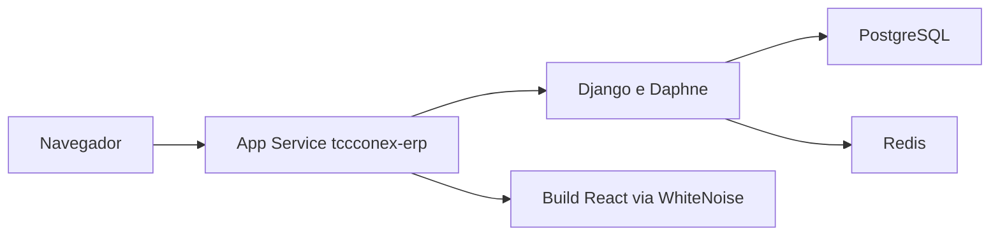

# Arquitetura

Um único processo Django atende a API e, quando existe o build, a interface React. Em produção isso roda no Azure App Service Linux `tccconex-erp`.

O diagrama usa os nomes do workflow e de `startup.sh`. A existência do servidor PostgreSQL e do Redis no portal está descrita no guia `docs/DEPLOY_AZURE.md`. A conferência ao vivo desses recursos nesta entrega: **pendente de confirmação**, porque a Azure CLI não está instalada nesta máquina.

## Peças

- `frontend/` compila com Vite para `frontend/dist`.
- O workflow de deploy copia esse build para `backend/frontend_dist` e gera `release.zip` só com o backend.
- `startup.sh` instala as dependências Python no container, aplica migrations quando `RUN_STARTUP_MIGRATE` não está desligado e sobe o Daphne em `prothon.asgi:application`.
- Se `USE_CELERY=True`, o mesmo script sobe um worker Celery em segundo plano.
- WhiteNoise entrega estáticos e o `index.html` do React. Rotas que não são `/api/`, `/admin/`, `/media/`, `/static/` nem `/assets/` caem no `index.html` (`spa_index` em `prothon/urls.py`).

## O que não há no repositório

Segundo App Service, deployment slot e workflow de homologação: não encontrados. OpenAPI ou Swagger: não encontrados.
