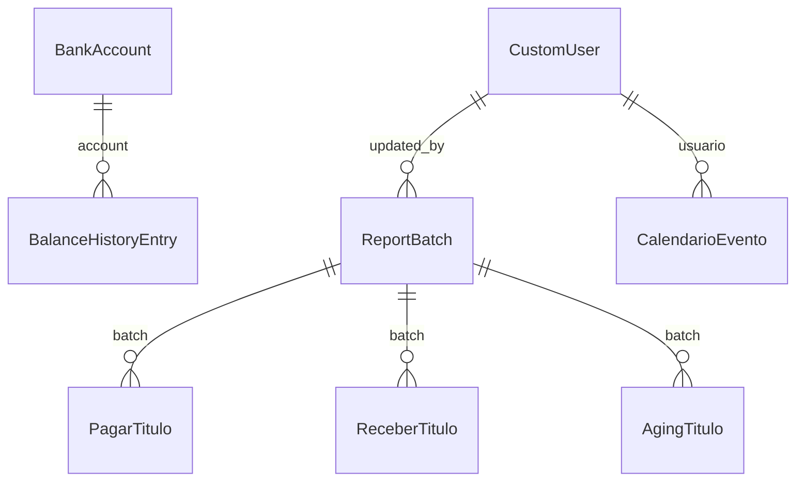

# Modelos e tabelas

Lista das classes `models.Model` e de `CustomUser` encontradas nos `models.py`. Relacionamentos são os campos `ForeignKey`, `OneToOneField` e `ManyToManyField` de cada classe.

Colunas abaixo foram lidas nos `models.py`. Chave primária omitida é o `id` automático do Django. Onde a lista não cobre o model inteiro, a página diz o arquivo que ainda precisa ser lido.

## accounts

Tabela de `Role`: `accounts_role`. PK de `Role` é `id` (`CharField`, tamanho 10), não o inteiro automático.

| Coluna | Tipo | Observação |
|---|---|---|
| `id` | CharField | PK |
| `name` | CharField | |
| `description` | TextField | blank |
| `permissions` | JSONField | lista, blank |

`CustomUser` estende `AbstractUser`. Tabela: `accounts_customuser`. Além das colunas do usuário do Django (`username`, `password`, `email`, `is_staff`, `is_active`, `date_joined`, entre outras), o model declara:

| Coluna | Tipo | Observação |
|---|---|---|
| `name` | CharField | blank |
| `cargo` | CharField | blank |
| `telefone` | CharField | blank |
| `cpf` | CharField | até 11, blank |
| `role_id` | CharField | padrão `2`. `1` é administrador |
| `status` | CharField | padrão `ativo` |
| `environments` | JSONField | lista de ambientes |
| `filiais` | JSONField | objeto por ambiente |
| `indicadores` | JSONField | lista. Vazia significa todos |
| `indicador_filiais` | JSONField | recorte por indicador |
| `funcoes` | JSONField | funções do operador por ambiente |
| `abas` | JSONField | abas por ambiente |
| `aba_filiais` | JSONField | filiais de cada aba |
| `funcao_filiais` | JSONField | filiais de cada função |
| `google_email` | EmailField | null, blank |
| `google_sub` | CharField | null, blank |
| `google_linked_at` | DateTimeField | null, blank |
| `google_token` | JSONField | null, blank. Segredo de sessão Google; não documentar o valor |
| `google_picture_url` | URLField | blank |
| `must_change_password` | BooleanField | padrão falso |

Não há `ForeignKey` de `CustomUser` para `Role`. O papel é o texto `role_id`.

## financeiro

`ReportBatch` (`financeiro_reportbatch`): `label`, `reference_date`, `updated_by` para `CustomUser` com `SET_NULL` e null, `is_active`, `imported_pagar`, `imported_receber`, `imported_aging`, `created_at`.

`PagarTitulo`: `batch` (`CASCADE`), `filial`, `cod_forn`, `fornecedor`, `titulo`, `tipo`, `emissao`, `vencimento`, `vencimento_real`, `valor` e `saldo` (`Decimal` 14,2), `historico` blank, `pr_desconsiderada`.

`ReceberTitulo`: `batch` (`CASCADE`), `filial`, `cod_cliente`, `cliente`, `titulo`, `natureza`, `emissao`, `vencimento`, `vencimento_real`, `valor`, `saldo`, `historico` blank.

`AgingTitulo`: `batch` (`CASCADE`), `origem`, `cod_cliente`, `cliente`, `loja`, `docto`, `serie`, `tipo`, `emissao`, `vencimento`, `regiao`, `total`.

`BillingRecord`: `reference_date`, `branch`, `value`, `notes_count`. `unique_together` de `reference_date` e `branch`.

`CashAdjustment`: `reference_date`, `adjustment_type`, `value`, `observation`, `created_by`.

`CaixinhaLancamento`: `reference_date`, `movement_type`, `value`, `description`, `created_by` blank.

`CaixinhaDescricao`: `movement_type`, `description`, `created_by` blank. `UniqueConstraint` `uniq_caixinha_descricao_tipo` em `movement_type` + `description`.

`BankAccount`: `bank`, `agency`, `number`, `account_type`, `balance`, `credit_limit`, `last_updated`.

`CalendarioEvento`: `usuario` (`CASCADE` para `CustomUser`), `titulo`, `descricao` blank, `data`, `cor` padrão `azul`, `created_at`, `updated_at`.

`BalanceHistoryEntry`: `account` (`CASCADE` para `BankAccount`), `reference_date`, `bank`, `number`, `entry_type`, `value`.

## indicadores

`IndicadorKpi`: `label`, `value`, `change`, `up` (padrão verdadeiro), `sort_order`.

`IndicadorFilial`: `filial`, `receita`, `fretes`, `toneladas`, `meta`, `sort_order`.

`MetaFaturamentoMensal`: `ano`, `mes`, `valor` (`Decimal` 15,2). Único por `ano` + `mes`. O realizado do indicador não fica neste model; vem de `BillingRecord`.

`GerencialSnapshot`: `reference_date` único, `batch_label` blank, `fat_dia`, `fat_mes`, `fat_ano`, `saldo_banco`, `duplicatas_a_receber`, `ctas_rec_atrasadas`, `ctes_emitidos`, `a_disponibilizar`, `contas_pagar_ate_corte`, `pagar_cutoff_date` null, `ctas_pag_atrasadas`, `saidas_previstas`, `posicao_gerencial`, `caixa_positivo_ate` blank, `sent_by` blank, `sent_at`. Não há chave estrangeira destes quatro models para o financeiro. O realizado da meta é lido na view.

## audit

`AuditLog`.

## rh

`Colaborador`: `cpf` único, `matricula`, `nome_completo`, `empresa`, `filial`, `departamento`, `cargo`, `situacao`, `data_admissao`, `data_demissao`, `telefone`, `nome_lider`, `data_nascimento`, `escolaridade`, `sexo` (`M` ou `F`), `regime` padrão `CLT`, `categoria`, `data_atualizacao`, `desconsiderado`.

`FuncionarioQuadro`: `nome`, `cpf` único, `filial`, `cargo`, `departamento`, `data_admissao`, `data_demissao`, `ativo` padrão verdadeiro, `criado_em`.

`LoteMovimentacaoRH`: `mes`, `ano`, `data_importacao`, `usuario` (`SET_NULL` para `CustomUser`), `arquivo`. Único por `mes` + `ano`.

`MovimentacaoColaborador`: `lote` (`CASCADE`), `filial`, `nome`, `situacao`, `uf_estado`, `funcao`, `data_admissao`, `data_nascimento`, `cpf`, `pis_pasep`, `rg`, `salario` (`Decimal` 12,2), `categoria`.

`InconsistenciaColaborador`: `lote` (`CASCADE`), `cpf`, `nome`, `tipo` padrão `salario`, `valor_anterior`, `valor_atual`, `justificativa`, `data_criacao`.

`CargoMapping`: `cargo` único, `categoria`, `data_criacao`, `ultima_atualizacao`.

`ColaboradorPJ`: `nome`, `cpf` único, `salario`, `filial`, `cargo`, `data_admissao`, `data_demissao`, `data_nascimento`, `ativo`, `data_criacao`.

`ColaboradorPJHistorico`: `pj` (`ForeignKey`), `ano`, `mes`, `salario`, `cargo`, `filial`, `motivo`, `data_criacao`. Único por `pj` + `ano` + `mes`.

`DocumentoRH`: `titulo`, `arquivo`, `drive_file_id`, `link_externo`, `nome_original`, `tamanho`, `texto`, `texto_extraido`, `incluido_por` e `pasta` (`ForeignKey`), `criado_em`.

`PastaMatrizRH`: `nome`. Demais campos do model estão em `apps/rh/models.py`.

## compras

Há duas classes `Colaborador`: `rh.Colaborador` e `compras.Colaborador`. São tabelas diferentes.

`UnidadeMedida.nome` e `Setor.nome` são únicos. `Fornecedor.nome` é único. `ItemEstoque`: `nome` único, `unidade` padrão `Un`, `qtd_atual`, `qtd_minima`.

`compras.Colaborador`: `setor` (`ForeignKey`), `nome`, `cargo`, `cpf`. Único por `setor` + `nome` (`compras_colaborador_setor_nome_unique`).

`EntradaEstoque`: `item` e `fornecedor` com `SET_NULL`, mais os snapshots `item_nome` e `fornecedor_nome`, `data`, `quantidade`, `valor_unitario`, `data_criacao`.

`SaidaEstoque`: `item`, `setor` e `colaborador` com `SET_NULL`, snapshots de nome, `data`, `quantidade`, `data_criacao`.

`Uniforme`: `nome`, `codigo`, `tamanho`, `qtd_nova`, `qtd_usada`, `estoque_minimo`, `criado_em`. Único por `nome` + `tamanho`.

`EntregaUniforme`: `colaborador` (`ForeignKey` para o colaborador de compras), snapshots de nome, CPF, cargo e setor, `data_entrega`, `observacoes`, `usuario` (`SET_NULL`), `usuario_nome`, `criado_em`.

`EntregaUniformeItem`: `entrega` (`PROTECT`), `uniforme` (`SET_NULL`), snapshots, `condicao`, `quantidade`, `qtd_devolvida`, `qtd_descartada`, `qtd_perdida`.

`DevolucaoUniforme`: `entrega` (`PROTECT`), `data_devolucao`, `observacoes`, `usuario`, `usuario_nome`, `criado_em`.

`DevolucaoUniformeItem`: `devolucao` e `entrega_item` com `PROTECT`, `qtd_boa`, `qtd_danificada`, `qtd_sem_condicoes`, `qtd_perdida`.

`MovimentacaoUniforme`: `tipo`, `uniforme` (`SET_NULL`), snapshots, `condicao`, `quantidade`, `variacao_estoque`, `saldo_novo`, `saldo_usado`, `data`, `colaborador`, `entrega`, `devolucao`, `observacao`, `usuario`, `usuario_nome`, `criado_em`.

## faturamento

`ClienteProtocolo`: `codigo`, `loja` padrão `01`, `tipo_pessoa`, `nome`, `razao_social`, `nome_fantasia`, `nome_interno`, `municipio`, `cnpj`, `padrao_protocolo`, `emitir_protocolo_canhotos`, `considerar_pesquisa_satisfacao`, `requer_expedicao`, `exige_filial`, `ultimo_numero_protocolo`, `emails_envio`, `emails_copia`, `data_criacao`, `data_atualizacao`. `codigo` + `loja` são únicos quando `codigo` não é vazio (`faturamento_cliente_codigo_loja_uniq`).

`FilialClienteProtocolo`: `cliente` (`ForeignKey`), `nome`. Único por `cliente` + `nome`.

`ProtocoloEnvio`: `data`, `cliente` (`ForeignKey`), `nota_fiscal`, `numero_sequencial`, `notas_filiais` (`JSONField`), `expedicao`, `usuario` (`ForeignKey`), `usuario_nome`, `data_criacao`, `data_atualizacao`.

`ProtocoloEnvioDraft`: `usuario` (`OneToOneField`), `version`, `payload`, `updated_at`.

`PagadorNd`: `cod_cliente` único, `nome`, `criado_em`, `criado_por` (`ForeignKey`).

`TituloNd`: `chave` única, `filial`, `cod_cliente`, `cliente`, `titulo`, `natureza`, `emissao`, `vencimento_real`, `saldo` (`Decimal` 14,2), `historico`, `baixado`, `atualizado_em`.

## sgq

`AuditoriaSGQ`: `filial`, `ano`, `sequencia`, `codigo` único, `categoria`, `titulo`, `data_inicio`, `data_termino`, `normas` (`ManyToMany` para `NormaSGQ`), `auditor_lider`, `auditores` (`JSONField`), `status` padrão `planejamento`, `escopo`, `criterios`, `processos_areas`, `responsaveis_processos`, `metodologia`, `consideracoes_finais`, `questionario_concluido`, `questionario_concluido_em` null, `planejamento` (`JSONField`), `criado_por` (`SET_NULL`), `criado_em`, `atualizado_em`. Único também por `ano` + `sequencia`.

`NormaSGQ` é única por `filial` + `nome`. `CategoriaAuditoriaSGQ` também. `TipoRespostaSGQ` é única por `filial` + `sequencia` e por `filial` + `nome`. `RespostaAuditoriaSGQ` liga `auditoria` (`CASCADE`) e `item` (`PROTECT`) e é única nesse par. `EscopoAnaliseOpcao.escopo` é `CASCADE` e a opção é única por `escopo` + `chave`. `ProcedimentoSipocSGQ.setor` é `PROTECT`.

As demais classes (`PesquisaSatisfacao`, rascunhos, `DocumentoSGQ`, `ItemNormaSGQ`, `AnexoRespostaAuditoriaSGQ`, `SetorSipocSGQ`, `PastaMatrizSGQ`) estão em `apps/sgq/models.py`. As colunas que não foram relidas aqui não são repetidas.

## marketing

`CampanhaMarketing`, `CampanhaComentario`, `CampanhaMembro`, `CampanhaMidia`.

## frota

`RespostaOlhoVivo`: `filial`, `periodicidade`, `ano`, `mes` null, `period_key`, `updated_by` (`ForeignKey`), `created_at`, `updated_at`. Único por `filial` + `period_key`.

`ItemRespostaOlhoVivo`: `resposta` (`CASCADE`), `comportamento`, `recorrencia`. Único por `resposta` + `comportamento`.

`UsuarioMotorista`: `funcionario` (`OneToOneField`), `username` único, `password`, `criado_em`, `criado_por` (`ForeignKey`). A senha fica neste model, separada de `CustomUser`.

`ParametroBonificacao`: `nota_inicial` padrão 100, `valor_bonus` padrão 500, `limitar_por_grupo`.

`FaixaBonificacao`: `nota_min`, `nota_max`, `modo`, `percentual`, `ordem`.

`GrupoCriterioDesempenho`: `nome`, `pontos_maximos`, `ordem`, `ativo`.

`CriterioDesempenho`: `grupo` (`ForeignKey`), `nome`, `descricao`, `pontos`, `zera_bonus`, `ativo`, `ordem`.

`OcorrenciaDesempenho`: `funcionario` e `criterio` (`ForeignKey`), `filial`, `data`, `quantidade`, `observacao`, `criado_em`, `criado_por`.

## comercial

`ClienteComercial`, `ProdutoComercial`, `ClienteComercialProduto`, `HomologacaoProdutoEvento`, `PropostaComercial`, `PropostaComercialDraft`, `PropostaFreteLinha`, `TabelaFrete`, `TabelaFreteLinha`, `GeneralidadeComercial`, `MatrizIcmsUf`, `ParametrosComercial`, `VeiculoComercial`, `VeiculoRotuloCliente`.

## notificacoes

`Notificacao`, `PushInscricao`.

## camilo

`Agente`, `ChatPadrao`, `TermoVersao`, `TermoAceite`, `PastaMatrizEmpresarial`, `DocumentoMatrizEmpresarial`.

## Sem model neste levantamento

`filesystem` e `logistica` não apareceram com classe `models.Model` em `models.py`. Logística lê configuração em views e o indicador de meta usa `MetaFaturamentoMensal` no app `indicadores`.
