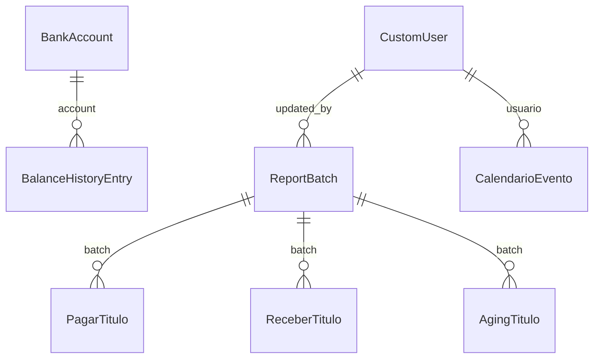

# Modelos e tabelas

Lista das classes `models.Model` e de `CustomUser` encontradas nos `models.py`. Relacionamentos são os campos `ForeignKey`, `OneToOneField` e `ManyToManyField` de cada classe.

Colunas abaixo foram lidas nos `models.py` de `accounts` e `financeiro`. Chave primária omitida é o `id` automático do Django. Os demais apps continuam listados pelo nome da classe; a coluna de cada um está no `models.py` citado.

## accounts

Tabela de `Role`: `accounts_role`. PK de `Role` é `id` (`CharField`, tamanho 10), não o inteiro automático.

| Coluna | Tipo | Observação |
|---|---|---|
| `id` | CharField | PK |
| `name` | CharField | |
| `description` | TextField | blank |
| `permissions` | JSONField | lista, blank |

`CustomUser` estende `AbstractUser`. Tabela: `accounts_customuser`. Além das colunas do usuário do Django (`username`, `password`, `email`, `is_staff`, `is_active`, `date_joined`, entre outras), o model declara:

| Coluna | Tipo | Observação |
|---|---|---|
| `name` | CharField | blank |
| `cargo` | CharField | blank |
| `telefone` | CharField | blank |
| `cpf` | CharField | até 11, blank |
| `role_id` | CharField | padrão `2`. `1` é administrador |
| `status` | CharField | padrão `ativo` |
| `environments` | JSONField | lista de ambientes |
| `filiais` | JSONField | objeto por ambiente |
| `indicadores` | JSONField | lista. Vazia significa todos |
| `indicador_filiais` | JSONField | recorte por indicador |
| `funcoes` | JSONField | funções do operador por ambiente |
| `abas` | JSONField | abas por ambiente |
| `aba_filiais` | JSONField | filiais de cada aba |
| `funcao_filiais` | JSONField | filiais de cada função |
| `google_email` | EmailField | null, blank |
| `google_sub` | CharField | null, blank |
| `google_linked_at` | DateTimeField | null, blank |
| `google_token` | JSONField | null, blank. Segredo de sessão Google; não documentar o valor |
| `google_picture_url` | URLField | blank |
| `must_change_password` | BooleanField | padrão falso |

Não há `ForeignKey` de `CustomUser` para `Role`. O papel é o texto `role_id`.

## financeiro

`ReportBatch` (`financeiro_reportbatch`): `label`, `reference_date`, `updated_by` para `CustomUser` com `SET_NULL` e null, `is_active`, `imported_pagar`, `imported_receber`, `imported_aging`, `created_at`.

`PagarTitulo`: `batch` (`CASCADE`), `filial`, `cod_forn`, `fornecedor`, `titulo`, `tipo`, `emissao`, `vencimento`, `vencimento_real`, `valor` e `saldo` (`Decimal` 14,2), `historico` blank, `pr_desconsiderada`.

`ReceberTitulo`: `batch` (`CASCADE`), `filial`, `cod_cliente`, `cliente`, `titulo`, `natureza`, `emissao`, `vencimento`, `vencimento_real`, `valor`, `saldo`, `historico` blank.

`AgingTitulo`: `batch` (`CASCADE`), `origem`, `cod_cliente`, `cliente`, `loja`, `docto`, `serie`, `tipo`, `emissao`, `vencimento`, `regiao`, `total`.

`BillingRecord`: `reference_date`, `branch`, `value`, `notes_count`. `unique_together` de `reference_date` e `branch`.

`CashAdjustment`: `reference_date`, `adjustment_type`, `value`, `observation`, `created_by`.

`CaixinhaLancamento`: `reference_date`, `movement_type`, `value`, `description`, `created_by` blank.

`CaixinhaDescricao`: `movement_type`, `description`, `created_by` blank. `UniqueConstraint` `uniq_caixinha_descricao_tipo` em `movement_type` + `description`.

`BankAccount`: `bank`, `agency`, `number`, `account_type`, `balance`, `credit_limit`, `last_updated`.

`CalendarioEvento`: `usuario` (`CASCADE` para `CustomUser`), `titulo`, `descricao` blank, `data`, `cor` padrão `azul`, `created_at`, `updated_at`.

`BalanceHistoryEntry`: `account` (`CASCADE` para `BankAccount`), `reference_date`, `bank`, `number`, `entry_type`, `value`.

## indicadores

`IndicadorKpi`, `IndicadorFilial`, `MetaFaturamentoMensal`, `GerencialSnapshot`.

## audit

`AuditLog`.

## rh

`Colaborador`, `FuncionarioQuadro`, `LoteMovimentacaoRH`, `MovimentacaoColaborador`, `InconsistenciaColaborador`, `CargoMapping`, `ColaboradorPJ`, `ColaboradorPJHistorico`, `DocumentoRH`, `PastaMatrizRH`.

## compras

`UnidadeMedida`, `Setor`, `Colaborador`, `Fornecedor`, `ItemEstoque`, `EntradaEstoque`, `SaidaEstoque`, `Uniforme`, `EntregaUniforme`, `EntregaUniformeItem`, `DevolucaoUniforme`, `DevolucaoUniformeItem`, `MovimentacaoUniforme`.

Há duas classes chamadas `Colaborador`: uma em `rh` e outra em `compras`. São models diferentes.

## faturamento

`ClienteProtocolo`, `FilialClienteProtocolo`, `ProtocoloEnvio`, `ProtocoloEnvioDraft`, `PagadorNd`, `TituloNd`.

## sgq

`PesquisaSatisfacao`, `PesquisaSatisfacaoLoteDraft`, `PesquisaSatisfacaoFormDraft`, `AuditoriaFormDraft`, `EscopoAnalise`, `EscopoAnaliseOpcao`, `DocumentoSGQ`, `AuditoriaSGQ`, `NormaSGQ`, `CategoriaAuditoriaSGQ`, `TipoRespostaSGQ`, `ItemNormaSGQ`, `RespostaAuditoriaSGQ`, `AnexoRespostaAuditoriaSGQ`, `SetorSipocSGQ`, `ProcedimentoSipocSGQ`, `PastaMatrizSGQ`.

## marketing

`CampanhaMarketing`, `CampanhaComentario`, `CampanhaMembro`, `CampanhaMidia`.

## frota

`RespostaOlhoVivo`, `UsuarioMotorista`, `ParametroBonificacao`, `FaixaBonificacao`, `GrupoCriterioDesempenho`, `CriterioDesempenho`, `OcorrenciaDesempenho`, `ItemRespostaOlhoVivo`.

## comercial

`ClienteComercial`, `ProdutoComercial`, `ClienteComercialProduto`, `HomologacaoProdutoEvento`, `PropostaComercial`, `PropostaComercialDraft`, `PropostaFreteLinha`, `TabelaFrete`, `TabelaFreteLinha`, `GeneralidadeComercial`, `MatrizIcmsUf`, `ParametrosComercial`, `VeiculoComercial`, `VeiculoRotuloCliente`.

## notificacoes

`Notificacao`, `PushInscricao`.

## camilo

`Agente`, `ChatPadrao`, `TermoVersao`, `TermoAceite`, `PastaMatrizEmpresarial`, `DocumentoMatrizEmpresarial`.

## Sem model neste levantamento

`filesystem` e `logistica` não apareceram com classe `models.Model` em `models.py`. Logística lê configuração em views e o indicador de meta usa `MetaFaturamentoMensal` no app `indicadores`.
